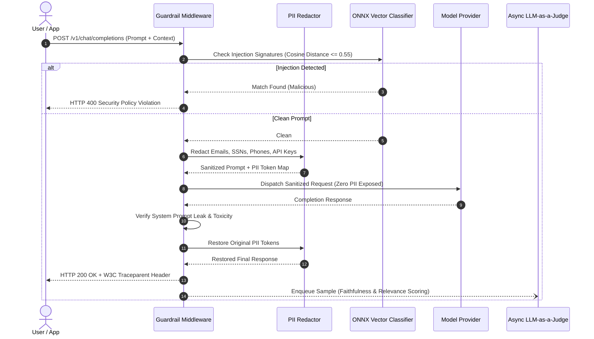
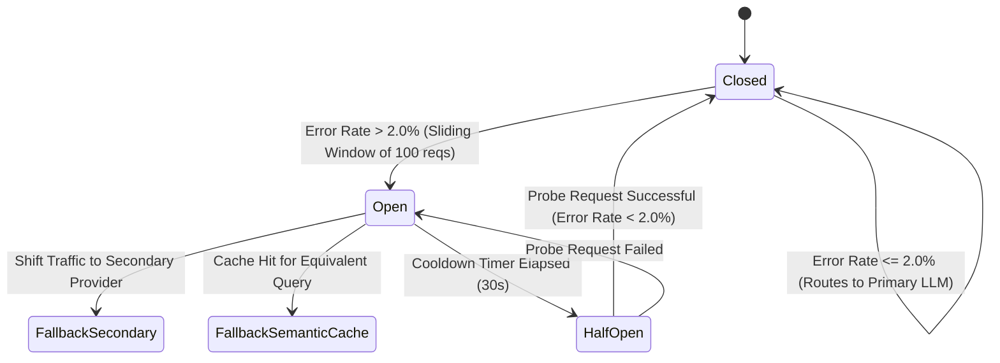

# LLM Guard & Observability System Architecture 🛡️📊

This document provides a comprehensive technical breakdown of the architecture, data flows, and design decisions behind **`llm-guard-observability`**.

---

## 1. High-Level Architectural Topology

The system operates as an ultra-low latency gateway and drop-in middleware layer positioned directly between client applications and upstream LLM providers (OpenAI, Anthropic, local vLLM).

```mermaid
flowchart TD
    Client["Client / Agent Loop\n(FastAPI / LangChain / LlamaIndex / SDK)"] -->|HTTP / W3C Traceparent| Gateway["LLM Guard Gateway Proxy\n(:8000)"]
    
    subgraph GuardrailEngine ["High-Performance Guardrail Engine (<15ms)"]
        IngressCheck["1. Ingress Filter\n- Regex Injections\n- ONNX Vector Distance\n- PII Tokenization"]
        EgressCheck["4. Egress Filter\n- System Prompt Leaks\n- Toxicity Filtering\n- PII Detokenization"]
    end

    subgraph ResilienceHarness ["Resilience & Failover Harness"]
        CircuitBreaker{"2. Circuit Breaker\n(Rolling Error > 2%)"}
        PrimaryLLM["Primary LLM API\n(OpenAI / Azure)"]
        SecondaryLLM["Secondary Fallback API\n(Anthropic / Bedrock)"]
        SemanticCache[("Local Semantic Vector Cache\n(Zero-latency backstop)")]
    end

    subgraph ObservabilityPipeline ["Observability & Evaluation Pipeline"]
        OTel["3. OpenTelemetry Tracer\n(W3C TraceContext, Spans, TTFT)"]
        Prometheus["Prometheus Exporter\n(Cin, Cout, Latency, Blocked)"]
        JudgeWorker["5. Async LLM-as-a-Judge\n(5-10% Sample: Faithfulness, Hallucination)"]
    end

    Gateway --> IngressCheck
    IngressCheck -->|Blocked: 400 Bad Request| Client
    IngressCheck -->|Allowed: Sanitized| CircuitBreaker
    
    CircuitBreaker -->|Healthy (<2% Errors)| PrimaryLLM
    CircuitBreaker -->|Tripped (>=2% Errors)| SecondaryLLM
    CircuitBreaker -->|Cache Hit| SemanticCache

    PrimaryLLM --> EgressCheck
    SecondaryLLM --> EgressCheck
    SemanticCache --> EgressCheck

    EgressCheck -->|Clean Response| Gateway
    Gateway -->|HTTP 200 + Headers| Client

    Gateway -.->|Trace & Latency| OTel
    Gateway -.->|Counters & Histograms| Prometheus
    Gateway -.->|Background Sampling| JudgeWorker
```

---

## 2. Ingress & Egress Guardrail Lifecycle

The guardrail pipeline enforces strict sub-15ms SLA latency bounds while scanning text before and after model generation.



---

## 3. Resilience & Circuit Breaker State Machine

To prevent cascading failures during upstream API degradations or regional outages, a rolling sliding-window circuit breaker monitors the error budget.



---

## 4. OpenTelemetry Tracing Standard

Every transaction adheres to the **W3C TraceContext** standard:
```text
traceparent: 00-4bf92f3577b34da6a3ce929d0e0e4736-00f067aa0ba902b7-01
              │  └───────────── trace_id ────────────┘ └─ span_id ─┘ └flags
              version
```

### Multi-Agent Parent-Child Hierarchy:
- **`RootSpan`** (Client Gateway Transaction)
  - **`AgentSpan`** (`OrchestratorAgent`)
    - **`SubAgentSpan`** (`ResearchAgent`)
      - **`ToolSpan`** (`VectorDBRetrieval`)
      - **`ToolSpan`** (`CodeInterpreter`)
    - **`ModelSpan`** (`OpenAI/gpt-4o`)

---

## 5. Continuous Async LLM-as-a-Judge

Rather than introducing blocking latency in the user request path, the gateway offloads 5% to 10% of production traffic to an asynchronous background worker.

### Evaluated Dimensions:
1. **Faithfulness ($0.0 - 1.0$)**: Degree to which the completion is strictly substantiated by the context.
2. **Answer Relevance ($0.0 - 1.0$)**: Alignment between the user's intent and the returned content.
3. **Hallucination Index ($0.0 - 1.0$)**: Inverse penalty score for ungrounded assertions.

---

## 6. Prometheus & Grafana Metrics Matrix

| Metric Name | Type | Description |
| :--- | :--- | :--- |
| `llm_guard_requests_total` | Counter | Total requests received by the gateway |
| `llm_guard_prompt_tokens_total` | Counter | Cumulative prompt tokens ($C_{in}$) |
| `llm_guard_completion_tokens_total` | Counter | Cumulative completion tokens ($C_{out}$) |
| `llm_guard_attacks_blocked_total` | Counter | Number of intercepted prompt injection attacks |
| `llm_guard_pii_redacted_total` | Counter | Count of sensitive PII tokens scrubbed |
| `llm_guard_ttft_seconds` | Histogram | Time to First Token distribution in seconds |
| `llm_guard_latency_seconds` | Histogram | End-to-end request latency distribution |
